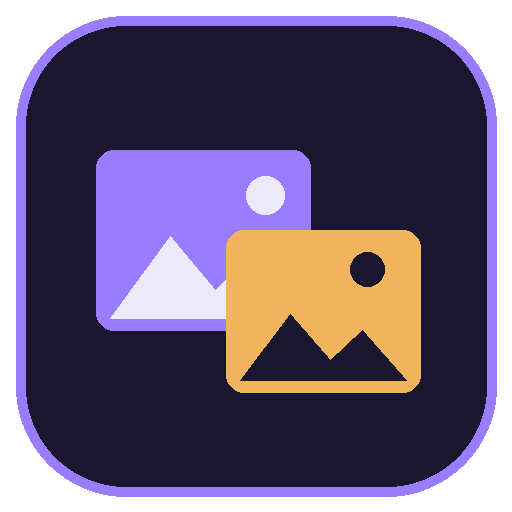
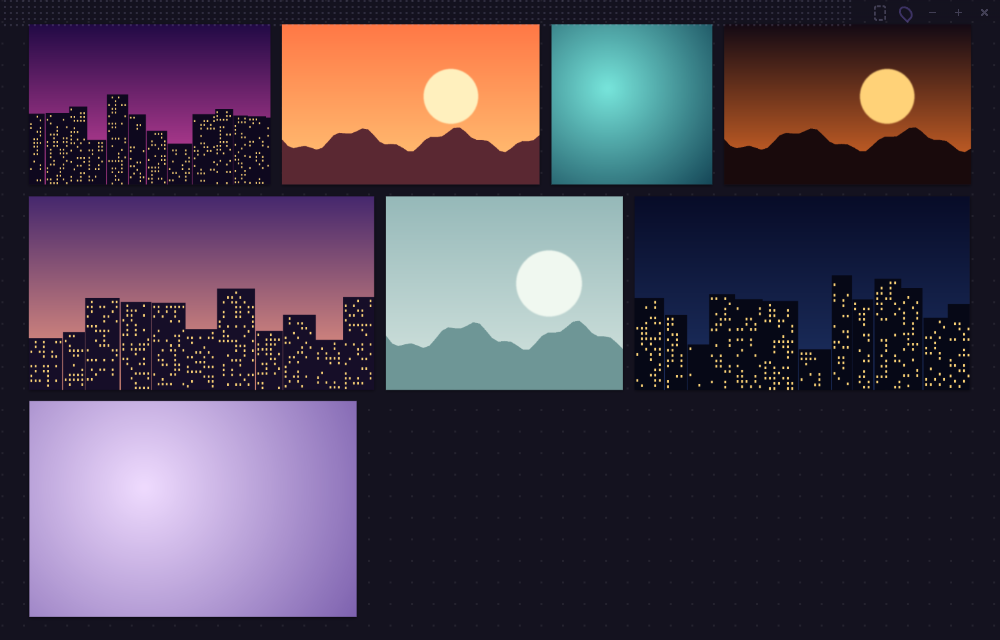
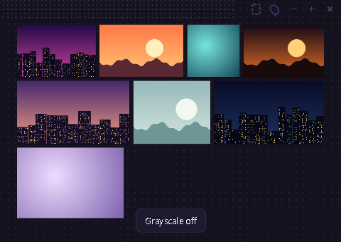

<p align="center">
  
</p>

<h1 align="center">Kanvaz Mini</h1>

<p align="center">A small reference window that stays on top of your work.<br>Drop images in, keep them beside you, get on with drawing.</p>

<p align="center">
  
</p>

Kanvaz Mini is the quick version of [Kanvaz](https://github.com/p4inz-code/kanvaz). Kanvaz is the full reference board for heavy work: connections, Map View, 3D models, video, plugins. Mini does one job. It opens in a second, floats over whatever you are working in, and holds a handful of images. There is nothing to set up and nothing to learn.

It is free, open source under the MIT license, and it never uses the network.

## Why it exists

Most days you do not need a whole board. You need three or four pictures next to your canvas. Mini is built for that: no account, no library, no panels. When a project grows into something bigger, Kanvaz is the next step, and Mini's boards stay plain files you own.

## What it does

- Opens small in a corner of your screen, always on top, and remembers where you put it.
- Takes images and GIFs by drag and drop, paste (`Ctrl+V`) or `Ctrl+O`.
- Moves, scales from a corner with the aspect ratio kept, rotates a quarter turn, flips, duplicates, deletes. Undo and redo go back 50 steps.
- Arranges everything into a tidy wall of rows with one key (`A`).
- Turns images to grayscale with one key (`G`), so you can check values.
- Has a click-through tracing mode (`Ctrl+Alt+T`): the window ignores the mouse so you can draw on the app underneath. Set the window opacity with `Ctrl+[` and `Ctrl+]`.
- Steps through your references one at a time with the left and right arrow keys.
- Opens PureRef `.pur` boards, with each image at its saved position and scale.
- Saves boards as single `.kmini` files with the images inside.
- Brings your last session back when you reopen it, so a quick close never loses your references.

Mini shows images and GIFs only. Video, audio, 3D models, PDFs and Adobe files are refused with a short message. Open those in Kanvaz.

<p align="center">
  
  
</p>

## Keys

Press `?` in the app for the same list.

| Key | What it does |
|---|---|
| Drop, `Ctrl+V`, `Ctrl+O` | Add images |
| Drag a card, drag a corner | Move, scale |
| `Shift` + click | Add to the selection |
| Drag on empty space | Select with a box |
| Middle or right drag, or `Space` + drag | Pan |
| Wheel | Zoom |
| `F`, `0`, `+`, `-` | Fit, 100%, zoom in, zoom out |
| `R`, `Shift+R` | Rotate a quarter turn |
| `H`, `V` | Flip left to right, flip top to bottom |
| `G` | Grayscale on and off |
| `A` | Arrange into rows |
| `Delete` | Remove the selection |
| `Ctrl+Z`, `Ctrl+Y` | Undo, redo |
| `Ctrl+A`, `Ctrl+D` | Select all, duplicate |
| `Ctrl+N` | New board |
| Arrow keys | Nudge the selection (hold `Shift` for 10 px), or step through references |
| `Ctrl+[`, `Ctrl+]` | Window more or less see-through |
| `P` | Keep on top on or off |
| `Ctrl+Alt+T` | Click-through tracing mode |
| `Ctrl+S` | Save the board |
| `?` | Show the key list |

R, H, V and G act on the selection, or on everything when nothing is selected.

## Download

Get the latest build from the Releases page of this repository.

- Windows: `Kanvaz Mini Setup <version>.exe` installs it. `Kanvaz Mini <version>.exe` is a portable copy that needs no install.
- Linux: the AppImage. Run `chmod +x` on it and start it.
- macOS: not targeted yet. Keep-on-top over full-screen apps has not been tested there.

Mini is not code-signed, so Windows SmartScreen will warn you the first time. Choose More info, then Run anyway. The source is here and every release lists its checksums.

## Guide

The Kanvaz user guide has a page for Mini, plus the FAQ, the troubleshooting page and a contact page: [p4inz-code.github.io/kanvaz/guide](https://p4inz-code.github.io/kanvaz/guide/).

- [Kanvaz Mini in the guide](https://p4inz-code.github.io/kanvaz/guide/kanvaz-mini.html)
- [FAQ](https://p4inz-code.github.io/kanvaz/guide/faq.html)
- [Contact and support](https://p4inz-code.github.io/kanvaz/guide/contact.html)

## Privacy and safety

Mini makes no network requests at all. The app blocks them, and a test checks that. It asks for no permissions and stores nothing outside its own settings and recovery files. It runs sandboxed with a strict content security policy, reads only image files and boards from real local paths, and caps the size of what it reads. See [PRIVACY.md](PRIVACY.md) and [SECURITY.md](SECURITY.md).

## Build and test

```bash
npm install
npm start
npm test
npm run build:win
npm run build:linux
```

`npm test` runs the unit tests for the board logic and the file rules. The live checks drive the real app over the Chrome DevTools protocol (34 of them, including the built exe):

```powershell
./test/live/launch.ps1
node test/live/cdp.js test/live/run-live.js
./test/live/kill.ps1
```

## Support

Mini is free and made by one person. If it saves you time, a star helps other artists find it, and the [support page](https://p4inz-code.github.io/donate/) takes UPI in India and cards anywhere. Questions and bug reports are welcome in the issues.

## License

MIT. Made by Atharva Patil | P4inz | P4inz Interactive Labs. The PureRef reader comes from Kanvaz, see [THIRD_PARTY_NOTICES.md](THIRD_PARTY_NOTICES.md).
